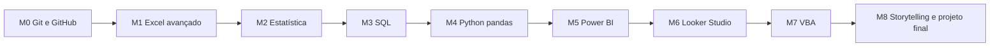

# Comece aqui

Este curso leva você de "em estudo" a "sei usar e tenho prova no GitHub" em 9 ferramentas pedidas nas vagas de Analista de Dados Júnior. São 21 aulas e 5 projetos de portfólio, pensados para **6 a 8 horas por semana durante 12 semanas**.

## Como cada aula funciona

Toda aula segue o mesmo roteiro:

1. **Objetivo:** o que você vai conseguir fazer no final.
2. **Analogia:** uma comparação com algo do dia a dia (muitas vêm do caixa e da recepção do hotel, que você conhece bem).
3. **O que é de verdade:** o conceito técnico, em poucas frases.
4. **Mão na massa**, em três degraus:
   - *Eu faço:* um exemplo completo, explicado parte por parte.
   - *Fazemos juntos:* um exemplo com lacunas para você completar.
   - *Você faz:* um desafio sem resposta pronta.
5. **Checagem:** perguntas para responder com suas palavras. Escreva as respostas no seu `progresso-aprendizado.md` antes de abrir o gabarito.
6. **No seu portfólio:** o que salvar e enviar para o GitHub.

Quando travar, peça ajuda ao Claude com `/professor-tech` e diga em qual aula você está. Ele lê o seu arquivo de progresso e explica de outro jeito.

## Ferramentas (todas gratuitas)

| Ferramenta | Para quê | Onde |
|---|---|---|
| Git + GitHub Desktop | Versionar e publicar o portfólio | git-scm.com e desktop.github.com |
| Excel (Microsoft 365) | Módulos 1, 2 e 7 | Já instalado |
| DB Browser for SQLite | Rodar SQL sem instalar servidor | sqlitebrowser.org |
| Google Colab | Python no navegador, sem instalar nada | colab.research.google.com |
| Power BI Desktop | Dashboards | Microsoft Store (Windows) |
| Looker Studio | Dashboards online | lookerstudio.google.com |
| VS Code (opcional) | Editar arquivos .md, .sql e .py | code.visualstudio.com |

## A trilha

A ordem importa. O Git vem primeiro para que tudo o que você fizer já vá para o portfólio. O SQL vem antes do Python porque a lógica de "filtrar, agrupar e juntar tabelas" é a mesma e fica mais fácil de ver em SQL.

## Cronograma de 12 semanas

| Semana | Aulas | Entrega |
|---|---|---|
| 1 | 01 Git e GitHub · 02 Tabela dinâmica | Repositório publicado |
| 2 | 03 PROCX e SOMASES · 04 Power Query | Planilha de metas × realizado |
| 3 | 05 Medidas de resumo · 06 Variação e correlação | Relatório estatístico |
| 4 | 07 SELECT e WHERE · 08 GROUP BY | |
| 5 | 09 JOIN · 10 CTE, CASE e janelas | **Projeto 1: análise de vendas em SQL** |
| 6 | 11 pandas básico · 12 groupby, merge e datas | |
| 7 | 13 Gráficos | **Projeto 2: conciliação de recebíveis em Python** |
| 8 | 14 Power Query e modelo estrela · 15 DAX | |
| 9 | 16 Montando o dashboard | **Projeto 3: dashboard Power BI** |
| 10 | 17 Looker Studio | **Projeto 4: painel no Looker Studio** |
| 11 | 18 Macros · 19 VBA com laços | **Projeto 5: fechamento de caixa automatizado** |
| 12 | 20 Storytelling · 21 Projeto final | Portfólio completo e currículo atualizado |

Atrasou? Tudo bem. Mantenha a ordem e não pule a checagem: ela é o que faz o conteúdo ficar.

## Quando o "Em estudo" vira competência no currículo

| Ferramenta | Prova no GitHub | Como escrever no currículo |
|---|---|---|
| Git/GitHub | Repositório com 20+ commits e README | Git e GitHub (versionamento de projetos) |
| Excel avançado | Aulas 02–04 concluídas | Excel avançado: tabela dinâmica, PROCX, SOMASES e Power Query |
| Estatística | Aulas 05–06 concluídas | Estatística descritiva aplicada a vendas |
| SQL | Projeto 1 | SQL: consultas com JOIN, agregações, CTEs e funções de janela |
| Python/pandas | Projeto 2 | Python (pandas, matplotlib) para limpeza e conciliação de dados |
| Power BI | Projeto 3 | Power BI: Power Query, modelagem estrela e DAX |
| Looker Studio | Projeto 4 | Looker Studio |
| VBA | Projeto 5 | VBA para automação de rotinas no Excel |
| Storytelling | Projeto final | Apresentação de resultados para áreas de negócio |

## Regras de ouro

- **Nunca** coloque dados reais do hotel onde você trabalhou no GitHub. Use sempre a base fictícia da pasta `dados/`.
- Faça commit no fim de cada aula, mesmo que incompleta. Histórico de commits mostra constância para o recrutador.
- Errou? Ótimo. Anote o erro no progresso. Erros anotados viram revisão nas próximas aulas.
