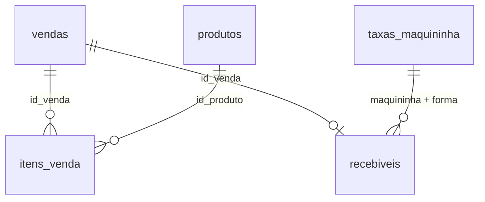

# Dados do curso: Empório Serra Alta

Base **fictícia** de uma loja de chocolates e cafeteria dentro de um hotel na serra gaúcha. Os números foram gerados pelo script `gerar_dados.py` (semente fixa, então todo mundo obtém os mesmos dados). Nenhum dado real de empresa ou cliente foi usado. O `loja.xlsx` é a conversão dos CSVs para o Excel.

Período: 01/01/2024 a 31/12/2025, cerca de 25 mil vendas.

## Arquivos

| Arquivo | O que é | Usado em |
|---|---|---|
| `vendas.csv` | Uma linha por venda (cupom) | Todas as aulas |
| `itens_venda.csv` | Uma linha por produto dentro de cada venda | SQL, pandas, Power BI |
| `produtos.csv` | Cadastro de 30 produtos | SQL, pandas, Power BI |
| `metas_mensais.csv` | Meta de faturamento de cada mês | Excel, Power BI, Looker |
| `taxas_maquininha.csv` | Taxa e prazo de cada maquininha | Conciliação (pandas) |
| `recebiveis.csv` | O que a operadora deveria pagar e o que pagou | Conciliação (pandas) |
| `export_pdv_dez2025.csv` | Exportação "suja" do sistema de caixa de dez/2025 | Power Query |
| `loja.xlsx` | vendas, itens, produtos e metas já como Tabelas do Excel (`tbVendas`, `tbItens`, `tbProdutos`, `tbMetas`) | Excel, Power BI, Looker, VBA |
| `loja.db` | Todas as tabelas acima num banco SQLite | SQL |

Os `.csv` usam ponto como separador decimal (padrão internacional, que Python e SQL entendem). No Excel, Power BI e Google Sheets em português, prefira o `loja.xlsx`, que já traz números e datas no formato certo.

## Dicionário de dados

### vendas
| Coluna | Tipo | Descrição |
|---|---|---|
| id_venda | inteiro | Número único da venda |
| data | data (AAAA-MM-DD) | Dia da venda |
| hora | texto (HH:MM) | Hora da venda |
| canal | texto | Loja, Recepção ou Online |
| forma_pagamento | texto | Crédito, Débito, PIX, Dinheiro ou Lançado no quarto |
| bandeira | texto | Visa, Mastercard ou Elo (vazio quando não é cartão) |
| maquininha | texto | Stone, Vero, PIX ou vazio |
| valor_total | decimal | Valor da venda em R$ |

### itens_venda
| Coluna | Descrição |
|---|---|
| id_venda | Liga com `vendas.id_venda` |
| id_produto | Liga com `produtos.id_produto` |
| quantidade | Unidades vendidas |
| preco_unitario | Preço de tabela |
| desconto_pct | 0.10 = 10% de desconto |
| valor_item | quantidade × preço × (1 − desconto) |

### produtos
`id_produto`, `produto`, `categoria` (Chocolates, Trufas, Kits Presente, Sazonais, Cafeteria, Bebidas, Souvenirs), `preco_unitario`, `custo_unitario`.

### metas_mensais
`ano_mes` (AAAA-MM) e `meta` em R$.

### taxas_maquininha
`maquininha`, `forma_pagamento`, `taxa_percentual`, `prazo_dias` (dias até o dinheiro cair).

### recebiveis
| Coluna | Descrição |
|---|---|
| id_venda | Venda de origem |
| maquininha, forma_pagamento | Quem processou |
| data_venda, data_prevista | Quando vendeu e quando deveria receber |
| valor_bruto | Valor da venda |
| taxa_percentual | Taxa contratada |
| valor_liquido_esperado | Bruto menos a taxa contratada |
| data_recebida, valor_recebido | O que de fato caiu na conta (vazio = não recebido) |

**Atenção:** a tabela `recebiveis` tem problemas de propósito (pagamentos faltando, taxa cobrada a mais e atrasos). Encontrá-los é o objetivo do Projeto 2.

## Como ligar as tabelas

