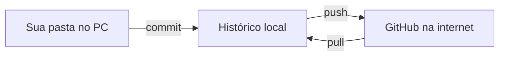

# Aula 01: Git e GitHub, seu portfólio no ar

**Objetivo:** no fim desta aula você terá este curso publicado no seu GitHub, com o seu primeiro commit.

**Tempo:** cerca de 2 horas.

## Analogia

Pense no livro de ocorrências da recepção. Cada turno escreve o que aconteceu, com data, hora e nome. Se algo deu errado, você volta as páginas e vê quando e quem mudou o quê.

- **Git** é esse livro de ocorrências, só que para arquivos. Cada registro se chama **commit** (uma "foto" dos arquivos naquele momento, com uma mensagem explicando o que mudou).
- **GitHub** é um site onde você guarda uma cópia do livro na internet, para os outros verem. É a vitrine do seu portfólio.

Onde a analogia quebra: no livro da recepção ninguém apaga páginas. No Git você até pode desfazer coisas, mas a ideia é a mesma: o histórico fica guardado.

## O que é de verdade

- **Repositório (repo):** a pasta do projeto acompanhada pelo Git.
- **Commit:** um ponto salvo no histórico, com mensagem.
- **Push:** enviar os commits do seu computador para o GitHub.
- **Pull:** trazer do GitHub o que mudou lá.
- **README.md:** a "capa" do repositório. O GitHub mostra esse arquivo na página inicial. É escrito em **Markdown** (texto simples com marcações, como `#` para título e `-` para lista).



## Mão na massa

### Eu faço: preparar o ambiente

1. Crie uma conta em github.com. Use um nome de usuário profissional, por exemplo `natandonato`. Ele vai aparecer no seu currículo.
2. Instale o **GitHub Desktop** (desktop.github.com). Ele instala o Git junto e dispensa o terminal no começo.
3. No GitHub Desktop: `File > Options > Accounts` e entre com a sua conta.
4. `File > Add local repository` e escolha a pasta deste curso. Ele vai dizer que a pasta ainda não é um repositório e oferecer **create a repository**. Clique nele.
   - Name: `analise-de-dados`
   - Git ignore: deixe *None* (o curso já tem um `.gitignore`)
5. Clique em **Publish repository**. Desmarque "Keep this code private" para que recrutadores vejam.

O que você deve ver: em `github.com/SEU-USUARIO/analise-de-dados`, a página com os arquivos do curso e o README.

### Fazemos juntos: o primeiro commit seu

1. Abra o arquivo `progresso-aprendizado.md` no Bloco de Notas ou no VS Code.
2. Na linha "Data de início", preencha a data de hoje. Salve.
3. Volte ao GitHub Desktop. Na esquerda aparece o arquivo alterado, com a linha antiga em vermelho e a nova em verde.
4. No campo **Summary**, escreva uma mensagem que diga *o que* mudou: `Inicia o curso: data de início`.
5. Clique em **Commit to main** e depois em **Push origin**.

Complete a regra de bolso: uma boa mensagem de commit começa com um ______ no presente (ex.: "Adiciona", "Corrige", "Inicia").

### Você faz

Edite o `README.md` da raiz: troque `SEU-PERFIL` pelo endereço do seu LinkedIn (se ainda não tiver perfil, apague o link por enquanto). Faça commit e push.

Resultado esperado: a página inicial do repositório mostra o README atualizado, com o seu nome no título.

## Bônus: os mesmos passos no terminal

Vagas citam "Git", não "GitHub Desktop". Vale conhecer os comandos (rode no PowerShell, dentro da pasta do curso):

```bash
git status
git add progresso-aprendizado.md
git commit -m "Atualiza progresso da aula 01"
git push
```

- `git status`: mostra o que mudou desde o último commit.
- `git add`: escolhe quais arquivos entram no próximo commit.
- `git commit -m "..."`: cria o commit com a mensagem.
- `git push`: envia ao GitHub.

## Checagem

Responda no `progresso-aprendizado.md`, com suas palavras:

1. Qual a diferença entre Git e GitHub?
2. Você fez commit mas não fez push. O recrutador vê a mudança? Por quê?
3. Por que nunca devemos subir para o GitHub as planilhas reais do hotel onde trabalhamos?

## No seu portfólio

Repositório público com README personalizado. Copie o link e guarde: ele entra no cabeçalho do currículo no fim do curso.

Próximo passo: Aula 02, tabela dinâmica.
