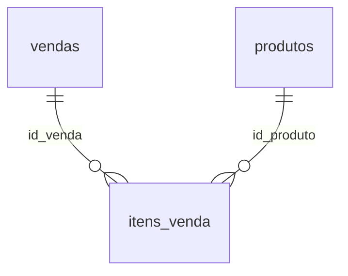

# Aula 09: JOIN, juntando tabelas

**Objetivo:** responder perguntas que precisam de mais de uma tabela, como "qual categoria fatura mais?" e "qual a margem de cada categoria?".

**Tempo:** cerca de 3 horas.

## Revisão rápida

1. O que o `HAVING` faz que o `WHERE` não faz?
2. Escreva de cabeça: faturamento por canal em 2024.

## Analogia

No hotel, a ficha da reserva tem o **número do quarto**, mas não o tipo do quarto. O tipo está em outra lista, o cadastro de quartos. Para saber "quantas diárias vendemos de suíte", você cruza as duas listas pelo número do quarto.

No Excel você fazia isso com PROCX. No SQL, isso é um **JOIN**: juntar duas tabelas por uma coluna em comum (a **chave**).

Onde a analogia quebra: o PROCX traz uma coluna de cada vez e só o primeiro resultado. O JOIN traz **todas** as colunas e **todas** as combinações que casam. Se uma venda tem 3 itens, ela aparece 3 vezes depois do JOIN com itens_venda. Isso é esperado, mas exige atenção ao somar.

## O que é de verdade



- `vendas`: uma linha por cupom (tem a data).
- `itens_venda`: uma linha por produto do cupom (tem quantidade e valor).
- `produtos`: cadastro (tem categoria e custo).

| Tipo | Traz | Uso típico |
|---|---|---|
| `JOIN` (ou `INNER JOIN`) | Só as linhas que casam nas duas tabelas | O dia a dia |
| `LEFT JOIN` | Tudo da tabela da esquerda, e da direita só o que casar (o resto vem `NULL`) | Achar o que **não** tem par |

```sql
SELECT ...
FROM itens_venda AS i
JOIN produtos    AS p ON p.id_produto = i.id_produto
```

`AS i` e `AS p` são **apelidos**: em vez de escrever `itens_venda.id_produto`, você escreve `i.id_produto`.

## Mão na massa

### Eu faço: faturamento por categoria em 2025

```sql
SELECT p.categoria,
       ROUND(SUM(i.valor_item), 2) AS faturamento
FROM itens_venda AS i
JOIN produtos    AS p ON p.id_produto = i.id_produto
JOIN vendas      AS v ON v.id_venda   = i.id_venda
WHERE v.data LIKE '2025%'
GROUP BY p.categoria
ORDER BY faturamento DESC;
```

Por que 3 tabelas? A categoria está em `produtos`, o valor do item em `itens_venda` e a data em `vendas`.

Validação: a soma das categorias deve dar o faturamento total de 2025 (R$ 1.309.451,42).

### Fazemos juntos: top 10 produtos de 2025

```sql
SELECT p.produto,
       SUM(i._________)            AS unidades,
       ROUND(SUM(i.valor_item), 2) AS faturamento
FROM itens_venda AS i
JOIN produtos    AS p ON p.id_produto = i.__________
JOIN vendas      AS v ON v.id_venda   = i.__________
WHERE v.data LIKE '2025%'
GROUP BY p.produto
ORDER BY faturamento DESC
LIMIT __;
```

### Você faz

1. **Margem bruta por categoria em 2025**, em R$ e em %. Custo = quantidade × custo_unitario. Qual categoria tem a maior margem percentual? E qual dá mais lucro em R$?
2. **LEFT JOIN:** quais produtos **não** venderam nada em junho/2025? Dica: primeiro faça uma subconsulta com os produtos vendidos em junho; depois faça `produtos LEFT JOIN (subconsulta)` e filtre onde o lado direito é `NULL`. Faz sentido o resultado?

## Checagem

1. Explique com suas palavras a diferença entre JOIN e LEFT JOIN.
2. Por que somar `v.valor_total` depois de juntar com itens_venda dá um número maior que o real?
3. Uma categoria tem a maior margem % e outra dá mais lucro em R$. Para o gerente, qual informação importa mais? Depende de quê?

## No seu portfólio

`minhas-consultas/aula-09.sql`. Commit: `Aula 09: JOINs entre vendas, itens e produtos`.

Próximo passo: Aula 10, CASE, CTE e funções de janela.
