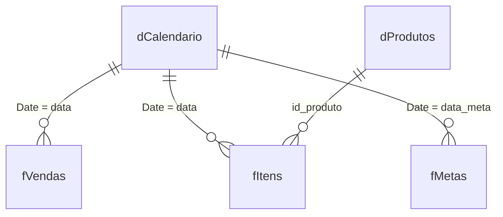

# Aula 14: Power BI, carregando os dados e montando o modelo estrela

**Objetivo:** carregar as tabelas da loja no Power BI Desktop, limpar com Power Query e ligá-las num **modelo estrela** que funciona.

**Tempo:** cerca de 3 horas. **Ferramenta:** Power BI Desktop (Microsoft Store, grátis).

## Revisão rápida

1. O que significa ETL? (Aula 04)
2. Qual a diferença entre uma tabela de vendas e uma tabela de produtos? Qual tem mais linhas?

## Analogia

Pense no organograma do hotel. No centro está a **recepção**, por onde passa todo o movimento do dia. Em volta ficam os cadastros que ela consulta: hóspedes, quartos, tarifas.

No Power BI é igual:

- **Tabela fato** (centro): o movimento, os acontecimentos. Muitas linhas. Ex.: vendas, itens vendidos.
- **Tabelas dimensão** (pontas): os cadastros que descrevem o movimento. Poucas linhas. Ex.: produtos, calendário.

Desenhado, fica parecido com uma estrela, daí o nome **modelo estrela**.

Onde a analogia quebra: no hotel, a informação vai e volta entre os setores. No Power BI, o filtro anda num sentido só, da dimensão para o fato (do "lado 1" para o "lado muitos").

## O que é de verdade



- **Relacionamento 1:\*** (um para muitos): um produto aparece em muitos itens vendidos.
- **Tabela calendário:** uma linha por dia. Ela é obrigatória para comparar períodos (mês anterior, ano anterior) na Aula 15.
- Prefixos `f` (fato) e `d` (dimensão) não são obrigatórios, mas deixam o modelo fácil de ler.

## Mão na massa

### Eu faço: carregar e tratar

1. `Página Inicial > Obter dados > Pasta de trabalho do Excel` e escolha `dados/loja.xlsx`.
2. No Navegador, marque as Tabelas `tbVendas`, `tbItens`, `tbProdutos` e `tbMetas` e clique em **Transformar dados**: abre o mesmo Power Query da Aula 04.
3. Confira os tipos: `data` como Data (não Data/Hora), `valor_total` como Número Decimal.
4. Renomeie as consultas: `tbVendas` → `fVendas`, `tbItens` → `fItens`, `tbProdutos` → `dProdutos`, `tbMetas` → `fMetas`.

Se um dia carregar os `.csv` em vez do `.xlsx`: eles usam ponto como decimal. Se o valor aparecer errado (1488 em vez de 148,8), use **Alterar tipo > Usando localidade > Inglês (Estados Unidos)**.

### Fazemos juntos: dar data aos itens e às metas

O item vendido não tem data; a data está na venda. Vamos trazer:

1. Selecione `fItens` > `Página Inicial > Mesclar Consultas`.
2. Escolha `fVendas` como segunda tabela e clique na coluna ______ nas duas (a chave).
3. Tipo de junção: **Externa esquerda**. Isso é o ______ JOIN do SQL.
4. Na coluna nova, clique na seta de expandir e marque só `data`.

Nas metas, `ano_mes` é texto ("2025-07"). Crie uma data no primeiro dia do mês:
`Adicionar Coluna > Coluna Personalizada`, nome `data_meta`, fórmula `Date.FromText([ano_mes] & "-01")`. Mude o tipo para Data.

Clique em **Fechar e Aplicar**.

### Você faz: o calendário e as relações

1. `Modelagem > Nova tabela` e cole:
   ```DAX
   dCalendario =
   ADDCOLUMNS (
       CALENDAR ( DATE ( 2024, 1, 1 ), DATE ( 2025, 12, 31 ) ),
       "Ano", YEAR ( [Date] ),
       "MesNum", MONTH ( [Date] ),
       "Mes", FORMAT ( [Date], "mmm" ),
       "AnoMes", FORMAT ( [Date], "yyyy-mm" ),
       "DiaSemana", FORMAT ( [Date], "ddd" )
   )
   ```
2. Selecione `dCalendario` > `Ferramentas de tabela > Marcar como tabela de data` > coluna `Date`.
3. Selecione a coluna `Mes` e use **Classificar por coluna > MesNum** (senão os meses saem em ordem alfabética: abr, ago, dez...).
4. Vá para a **Exibição de modelo** (ícone de diagrama, à esquerda) e arraste para criar as relações do diagrama acima. Apague relações que o Power BI tenha criado sozinho e que não estejam no desenho.

Teste: crie um visual de tabela com `dCalendario[Ano]` e a soma de `fVendas[valor_total]`. Deve dar R$ 1.232.094,15 em 2024 e R$ 1.309.451,42 em 2025.

## Checagem

1. Explique fato e dimensão usando um exemplo do hotel que não seja vendas.
2. Por que trouxemos a data para `fItens` em vez de ligar `fItens` direto em `fVendas`?
3. Os meses aparecem como "abr, ago, dez, fev...". O que faltou?

## No seu portfólio

Salve como `projetos/p3-power-bi-dashboard/dashboard-vendas.pbix`. Tire um print da Exibição de modelo (`modelo-estrela.png`). Commit: `Aula 14: modelo estrela no Power BI`.

Próximo passo: Aula 15, medidas DAX.
