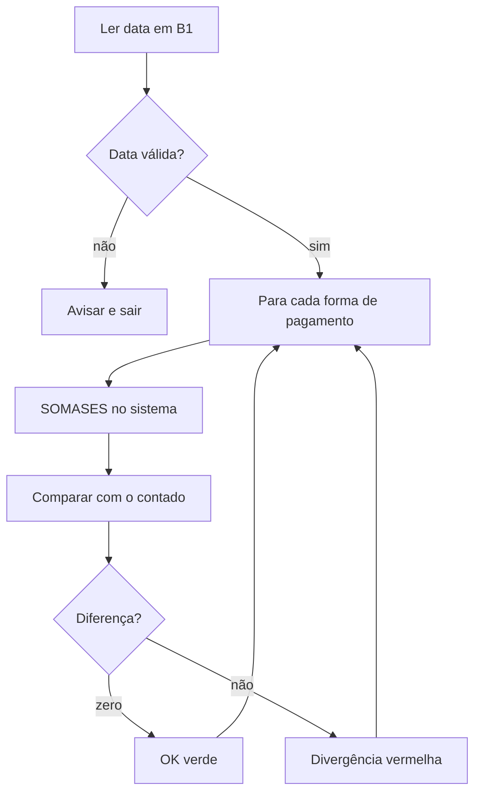

# Aula 19: VBA com laços, o fechamento de caixa automático

**Objetivo:** criar uma macro que fecha o caixa de qualquer dia: soma o sistema por forma de pagamento, compara com o contado e marca as diferenças. Depois, outra macro que monta o resumo do mês inteiro.

**Tempo:** cerca de 4 horas (inclui o Projeto 5). **Arquivo:** `projetos/p5-vba-fechamento-caixa/fechamento-caixa-modelo.xlsx`.

Você fazia esse fechamento à mão no hotel. Agora vai automatizar.

## Revisão rápida

1. Como achar a última linha com dados em VBA?
2. Por que salvar como `.xlsm`?

## Analogia

Um **laço** (`For`) é a conferência de comprovantes: "para cada forma de pagamento da lista, some os comprovantes dela e compare com o contado". Você escreve a instrução uma vez e o VBA repete para cada item.

Uma **condição** (`If`) é a decisão do conferente: "se bateu, carimba OK; se não bateu, marca divergência".

Onde a analogia quebra: o conferente percebe quando algo está estranho. O VBA não. Se a data estiver vazia ou o nome da forma de pagamento vier escrito diferente, ele soma zero e segue em frente. Por isso a macro precisa **checar** as entradas antes.

## O que é de verdade

```vba
Dim formas As Variant
formas = Array("Crédito", "Débito", "PIX")

For i = LBound(formas) To UBound(formas)   ' do primeiro ao último item
    ' faz algo com formas(i)
Next i

If diferenca = 0 Then
    ' ...
ElseIf diferenca > 0 Then
    ' ...
Else
    ' ...
End If
```

- `Array(...)`: uma lista. O primeiro item é o 0.
- `Application.WorksheetFunction.SumIfs(...)`: usa o SOMASES do Excel dentro do VBA (Aula 03!).
- `MsgBox "texto"`: mostra um aviso.
- `Exit Sub`: sai da macro (útil quando a entrada está errada).



## Mão na massa

Abra o modelo e salve como `fechamento-caixa.xlsm`. A aba `Fechamento` tem a data em B1 e o valor contado em C4:C8. A aba `Vendas` tem as vendas (data na coluna B, forma de pagamento na E, valor na H).

### Eu faço: somar uma forma de pagamento

No editor (Alt+F11), `Inserir > Módulo`:

```vba
Sub TesteCredito()
    Dim wsV As Worksheet, ultima As Long, total As Double
    Set wsV = ThisWorkbook.Worksheets("Vendas")
    ultima = wsV.Cells(wsV.Rows.Count, "A").End(xlUp).Row

    total = Application.WorksheetFunction.SumIfs( _
        wsV.Range("H2:H" & ultima), _
        wsV.Range("B2:B" & ultima), ThisWorkbook.Worksheets("Fechamento").Range("B1").Value, _
        wsV.Range("E2:E" & ultima), "Crédito")

    MsgBox "Crédito no sistema: " & Format(total, "R$ #,##0.00")
End Sub
```

O ` _` no fim da linha quer dizer "a instrução continua na linha de baixo".

Resultado esperado para 24/12/2025: **R$ 1.047,30**.

### Fazemos juntos: o laço

Transforme o teste num laço por todas as formas. Complete:

```vba
formas = Array("Crédito", "Débito", "PIX", "Dinheiro", "Lançado no quarto")
For i = LBound(formas) To ________(formas)
    linha = 4 + i
    sistema = Application.WorksheetFunction.SumIfs(rngValor, rngData, dataRef, rngForma, ______(i))
    wsF.Cells(linha, "B").Value = Round(sistema, 2)
    diferenca = Round(wsF.Cells(linha, "C").Value - sistema, 2)
    wsF.Cells(linha, "D").Value = diferenca
    If Abs(diferenca) < 0.01 Then
        wsF.Cells(linha, "E").Value = "OK"
    Else
        wsF.Cells(linha, "E").Value = "__________"
    End If
Next i
```

Por que `Abs(diferenca) < 0.01` e não `diferenca = 0`? Contas com decimais no computador às vezes dão 0,0000001 em vez de zero.

### Você faz

1. Complete a macro `FecharCaixa`: valide a data em B1 (se não for data, avise e saia), pinte a situação de verde ou vermelho e escreva o total do sistema em B10.
2. Com os valores de exemplo, o resultado de 24/12/2025 deve marcar **Dinheiro** com divergência de −R$ 10,00 e o resto OK.
3. Crie a macro `ResumoDoMes`: uma aba nova com uma linha por dia do mês da data em B1 e uma coluna por forma de pagamento. Dica: `For d = inicio To fim` funciona com datas, e o último dia do mês é `DateSerial(Year(inicio), Month(inicio) + 1, 0)`.
4. Bônus: `ExportarFechamentoPDF`, que salva a aba Fechamento em PDF com a data no nome (`ExportAsFixedFormat`).
5. Coloque três botões na aba Fechamento: "Fechar caixa", "Resumo do mês" e "Gerar PDF".

O gabarito completo está em `gabarito/FechamentoCaixa.bas`. Para importar: no editor, `Arquivo > Importar arquivo`.

## Checagem

1. O que acontece se alguém digitar "credito" (sem acento) na lista de formas? Como a macro poderia se proteger disso?
2. Por que validar a data em B1 antes de calcular?
3. Explique o `ResumoDoMes` para o gerente, sem falar de código.

## No seu portfólio

Siga o checklist do `projetos/p5-vba-fechamento-caixa/README.md`. Exporte o módulo como `.bas` (texto) para o GitHub mostrar o código. Commit: `Projeto 5: fechamento de caixa automatizado em VBA`.

Com o Projeto 5 publicado, você pode mover **VBA** para Competências.

Próximo passo: Aula 20, storytelling com dados.
